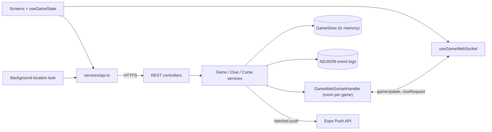

# UBCeek: Hide and Seek

A GPS hide-and-seek game for the UBC campus. Players use an Expo React Native app, and a Spring Boot server runs the game: it tracks hiders in the background and pushes every change to all phones over WebSockets.

<!--  -->
<!-- SHOT: hero.gif — split-screen recording of two phones in the same game: seeker buys "Distance from Seekers", hider's phone gets the push + in-app alert, seeker's Clues tab updates without refresh -->

Between 2 and 6 teams play as seekers or hiders. Seekers complete challenge cards (23 of them) to earn tokens, then spend them on clues about where the hiders are or on curses that slow them down. Hiders share their location automatically, even with the phone locked, and a hider team that gets found becomes a seeker team. Most total hiding time wins. The server owns the game state, timers, token balances and clue resolution, and there's a password-protected admin panel for the organiser.

| Clue | Cost | Range |
|---|---|---|
| Exact location | 15 | 300 m |
| Selfie (hider takes a photo) | 8 | 300 m |
| Closest building (hider answers) | 8 | 350 m |
| Relative direction (8-point compass) | 3 | 400 m |
| Distance from seekers | 3 | unlimited |

## How it works



Every state change goes through a service, which updates `GameStore`, appends to the game's event log and broadcasts the new `Game` snapshot to every socket in that game's room. Clients load the game once over REST and then just apply `gameUpdate` messages. Expo push notifications cover players whose app is backgrounded or closed.

## Interesting bits

- Polling to push. The first version had every screen poll REST on its own 5 to 15 s timer. Now every mutating service method calls `GameWebSocketHandler.broadcastToGame`, which keeps a per-session lock because Spring's `WebSocketSession.sendMessage` can't be called concurrently and broadcasts come from request threads and `@Scheduled` jobs at once. On the phone, `useGameWebSocket.ts` shares one socket per `(url, gameId)`, reconnects with exponential backoff (1 s up to 30 s), pings every 30 s and reconnects when the app comes back to the foreground.
- Location with the phone locked. A `TaskManager` task defined at module scope gets high-accuracy fixes every 10 s, with an Android foreground-service notification and the iOS background location mode. Background JS has no React state, so the active `gameId` and `teamId` go into AsyncStorage and get read back inside the task. An `expo-background-task` job and a foreground 10 s timer act as backups.
- Range-limited clues. `GameStore.getHidersWithinRange` uses haversine distance from the seeker's last fix, and if no hider is in range no tokens are spent. Direction is an `atan2` bearing bucketed into 8 compass points. Selfie and closest-building clues send the hider a request with a 1-minute expiry, and a scheduled sweep reveals their exact location if they ignore it.
- A server-side clock. Score is hiding time, so pauses and round limits have to be exact whatever the phones' clocks say. `RoundTimerService` ticks every second and pauses the game when a round runs out. `Game` tracks `totalPausedDuration` plus a snapshot of it at round start, so elapsed round time leaves out pauses, and each `Team` accumulates `totalHiderTime` across rounds.
- Logs and an admin view. `GameEventLogger` appends versioned events with a per-game sequence number to `events.ndjson`, and `LocationSnapshotLogger` records every team's position every 5 s, so a game can be replayed to settle disputes. The admin panel is served from the same WAR, and its Leaflet map joins the same WebSocket room as the players.

## Running it

You need JDK 21, Node.js with npm, and Android Studio and/or Xcode for development builds.

```bash
cd hideandseek_backend
./mvnw spring-boot:run                 # http://localhost:3000; REST at /api, socket at /ws, admin at /admin
./mvnw clean package -Pwildfly         # or build target/hideandseek.war for WildFly

cd ../frontend/HideAndSeekApp            # in a second terminal
npm install
npm start                              # Expo dev server
npm run android                        # or: npm run ios (development build)
```

- Backend env vars: `ADMIN_PASSWORD` for the admin panel (also read from `.env` or `admin.password`), and optionally `EXPO_ACCESS_TOKEN` and `EXPO_PUSH_ENDPOINT`. The properties `events.log.baseDir` and `uploads.selfies.dir` set where logs and selfies go.
- `API_BASE_URL` in `config/api.ts` points at the hosted server. For a local backend on a real phone, use `http://<LAN-IP>:3000/api`; the WebSocket URL is derived from it.
- Background location and push need a development build, not Expo Go. Android push also needs a Firebase `google-services.json` in the app root (gitignored). For an APK: `eas build --profile preview --platform android`.

The backend runs as a WAR on WildFly and Android builds come from EAS. <!-- TODO(Ayden): add how many campus games / players it has hosted, if you can verify it --> Known gaps: state is in memory only, so a restart clears all games; the full `Game` snapshot (team coordinates included) goes to every client and there's no per-player auth; and there are no automated tests yet.

Stack: Expo SDK 53, React Native 0.79, TypeScript, expo-location, expo-task-manager, expo-notifications, Leaflet, Java 21, Spring Boot 3.5, raw WebSockets, Expo Push API, WildFly.
