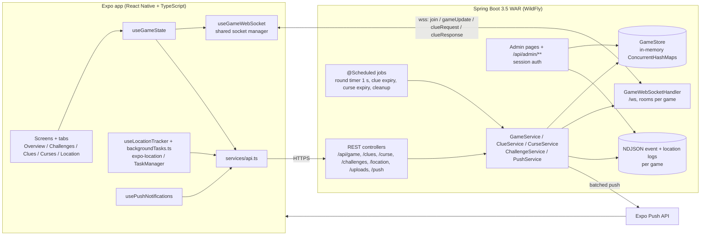

# UBCeek: Hide and Seek

A real-time, GPS-based hide-and-seek game for the UBC campus. Players use an Expo React Native app, and a Spring Boot server runs the game: it tracks hiders in the background and pushes every change to all phones over WebSockets.

<!--  -->
<!-- SHOT: hero.gif — split-screen recording of two phones in the same game: seeker buys "Distance from Seekers", hider's phone gets the push + in-app alert, seeker's Clues tab updates without refresh -->

## Overview

UBCeek turns campus hide-and-seek into a team game with an in-game economy. Between 2 and 6 teams play, split into seekers and hiders:

- **Seekers** complete challenge cards to earn tokens. They spend tokens on clues about where hiders are, or on curses that slow them down.
- **Hiders** share their location automatically, even with the phone locked. A hider team that is found becomes a seeker team.

The team with the most total hiding time wins. The server is authoritative for game state, timers, token balances and clue resolution, and an admin web panel lets an organiser watch every game live.

## Features

- **Lobby.** Create a game with 2–6 named teams, others join by 6-letter code, and each player picks a team and role.
- **Challenge deck.** 23 cards (easy, medium and hard) with fixed or player-entered token rewards. Vetoing a card locks the team out of drawing for 5 minutes.
- **Clues.** Five types, each with a cost and a range, set in `clue_types.json`. A clue targets only hiders within its range, and if no hider is in range, no tokens are spent.

  | Clue | Cost | Range |
  |---|---|---|
  | Exact location | 15 | 300 m |
  | Selfie (hider takes a photo) | 8 | 300 m |
  | Closest building (hider answers) | 8 | 350 m |
  | Relative direction (8-point compass) | 3 | 400 m |
  | Distance from seekers | 3 | unlimited |

- **Timed responses.** Hiders have 1 minute to answer selfie and closest-building requests. If they don't, their exact location is revealed automatically.
- **Curses.** Seven timed curses that seekers can buy and apply to hider teams.
- **Background location.** Hiders' locations are shared every 10 s, with an Android foreground-service notification and the iOS background location mode.
- **Notifications.** Push notifications with custom sounds for clue requests, curses, teams being found and game-state changes.
- **Map.** Location clues open in a Leaflet/OpenStreetMap view inside the app.
- **Rounds and scoring.** Optional round time limit, pause and resume, round rotation, and an end-of-game leaderboard ranked by hiding time.
- **Admin panel.** Password-protected, built into the server. It has a game list and stats, a live Leaflet map of every team, and event and location log downloads, plus force-end and cleanup actions.

## Architecture



Every state change goes through a service, which updates `GameStore`, appends to the game's event log and then broadcasts the new `Game` snapshot to every socket in that game's room. Clients load the game once over REST and from then on apply `gameUpdate` messages. Push notifications (through Expo) reach players whose app is backgrounded or closed.

## Engineering highlights

### 1. Replacing polling with WebSocket push
**Problem.** The first version had each screen and tab poll REST on its own timer, between 5 and 15 s. Updates arrived late, several requests were in flight per client, and phones used more battery.
**Approach.**
- **Server.** Every mutating method in `GameService`, `ClueService`, `CurseService` and `LocationService` calls `GameWebSocketHandler.broadcastToGame`. The handler keeps a `ConcurrentHashMap` of game rooms (`CopyOnWriteArraySet<WebSocketSession>`). It also keeps a **per-session lock**, because Spring's `WebSocketSession.sendMessage` can't be called concurrently, and broadcasts come from request threads and `@Scheduled` jobs at the same time.
- **Client socket manager.** `useGameWebSocket.ts` keeps one socket per `(url, gameId)` in a module-level manager map. Screens subscribe and unsubscribe through it without opening duplicate connections. The manager reconnects with exponential backoff (1 s, doubling to a 30 s cap), sends a 30 s heartbeat ping and reconnects when `AppState` returns to `active`.
- **Client state.** `useGameState.ts` combines an initial REST load with socket updates into one `{ game, currentTeam, connected, refresh }` interface.

**Result.** The steady-state polling loops were removed from `GameScreen`, `TeamJoinScreen`, `CursesTab`, `HiderClueListener` and the other tabs, and state changes now appear on every phone as soon as they happen.

### 2. Reliable background location on iOS and Android
**Problem.** Hiders put their phones away. Plain JS timers stop when the app is backgrounded, but the game depends on hider positions staying fresh.
**Approach.** The app uses three layers:
1. **Location task.** `backgroundTasks.ts` defines a `TaskManager` task at module scope, and `Location.startLocationUpdatesAsync` drives it at high accuracy every 10 s, with an Android foreground-service notification. Background JS has no React state, so the active `gameId` and `teamId` are written to AsyncStorage and read back inside the task.
2. **Periodic sync.** An `expo-background-task` job fetches the game, raises a local notification if its status changed and sends a fresh fix if the team is a hider.
3. **Foreground timer.** A 10 s timer is a backup while the app is open.

`app.json` declares the iOS `location`, `remote-notification` and `background-fetch` modes and the Android background-location permissions.
**Result.** Positions keep updating with the phone locked, which is what the range-limited clues below rely on.

### 3. Range-limited clues with asynchronous hider responses
**Problem.** Clues should depend on how close the seekers are, and some clues need a human answer (a selfie, or the name of the nearest building) without stalling the game.
**Approach.**
- **Targeting.** `GameStore.getHidersWithinRange` uses haversine distance from the seeker's last fix to keep only the hiders within the clue's range, sorted by distance. `ClueService` then dispatches on the clue type.
- **Immediate clues.** Exact location, distance and relative direction are resolved on the server. Direction is the bearing from `atan2`, bucketed into 8 compass points.
- **Request clues.** Selfie and closest-building clues create a `ClueRequest` with a 1-minute expiry. The request is broadcast over the socket and sent as a push to the target hider team. The hider answers in `HiderClueListener`: selfies are taken with `expo-image-picker` and uploaded as multipart to `FileUploadController`.
- **Expiry.** Scheduled sweeps find expired requests and create a separate exact-location clue for the seeker, then broadcast it.

**Result.** Hiders can't stall by ignoring a request, and seekers are never charged for a clue that has no target.

### 4. A server-side game clock that handles pauses
**Problem.** The scoring metric is hiding time, so pauses, round limits and role changes all have to be accounted for exactly, whatever any phone's clock says.
**Approach.**
- **Round timer.** `RoundTimerService` runs every second and calls `GameService.enforceRoundTimeLimits`. When a round's time is up, the game is paused and flagged `pausedByTimeLimit`, and expired curses are cleaned up.
- **Pause accounting.** The `Game` model tracks `totalPausedDuration` and a snapshot of it taken when each round starts (`pausedDurationAtRoundStart`), so elapsed round time leaves out pauses. Each `Team` accumulates `totalHiderTime` across rounds.
- **Cleanup.** The store is in memory, so `GameCleanupService` removes games after 12 hours of inactivity and logs aggregate stats every 30 minutes.

**Result.** Scores are computed in one place, on the server, and survive pauses, round rotation and clients reconnecting.

### 5. Event logging and an admin live view
**Problem.** In a real-world game, the organiser needs to see what's happening and to settle disputes afterwards.
**Approach.**
- **Event log.** `GameEventLogger` appends versioned events to `events.ndjson`, one file per game, with a per-game monotonically increasing sequence number (`AtomicLong`). It also writes a human-readable copy with team names resolved.
- **Location snapshots.** `LocationSnapshotLogger` records every team's position every 5 s.
- **Admin panel.** The panel is served from the same WAR (`admin-login`, `admin-dashboard` and `admin-game.html`). Its live map uses Leaflet and joins the same WebSocket room as the players.
- **Admin auth.** The `/api/admin/**` endpoints are protected by a session check (`AdminSecurityConfig`). The password comes from an env var, `.env` or a property, in that order (`AdminPasswordProvider`).

**Result.** Each game leaves a timestamped event and location log that can be replayed, and the organiser can watch all teams live from a browser.

## Tech stack

| Layer | Technologies |
|---|---|
| Mobile | Expo SDK 53, React Native 0.79 (New Architecture), React 19, TypeScript, React Navigation 7 (stack + bottom tabs), expo-location, expo-task-manager, expo-background-task, expo-notifications, expo-image-picker, expo-audio, AsyncStorage, react-native-webview + Leaflet |
| Backend | Java 21, Spring Boot 3.5 (Web, WebSocket, Validation, Scheduling), Jackson, Lombok, dotenv-java |
| Realtime and notifications | Raw WebSocket (`TextWebSocketHandler`), Expo Push API (batched 100 per request) |
| Hosting | WAR on WildFly (context root `/hideandseek`); EAS Build for Android APKs |
| Admin | Static HTML/JS with Leaflet, session-authenticated REST |

## Getting started

**Prerequisites:** JDK 21, Node.js with npm, and Android Studio and/or Xcode for development builds.

### Backend

```bash
cd hideandseek_backend
./mvnw spring-boot:run   # embedded Tomcat on http://localhost:3000
```

- REST lives under `/api`, the WebSocket at `/ws` and the admin panel at `/admin`. Game state is held in memory, so a restart clears all games.
- To package a WAR for WildFly, run `./mvnw clean package -Pwildfly`, which produces `target/hideandseek.war`. The `wildfly` profile marks the servlet container dependencies as provided.

| Env var / property | Required | Purpose |
|---|---|---|
| `ADMIN_PASSWORD` | for the admin panel | Admin login. Can also come from `.env` in the working directory or from `admin.password` |
| `EXPO_ACCESS_TOKEN` | no | Bearer token for Expo push, if push security is enabled on the Expo project |
| `EXPO_PUSH_ENDPOINT` | no | Overrides the Expo push URL |
| `events.log.baseDir` (property) | no | Where NDJSON game logs are written. The default is the WildFly data dir or `./hideandseek/logs/events` |
| `uploads.selfies.dir` (property) | no | Where selfie uploads are stored |

### Mobile app

```bash
cd frontend/HideAndSeekApp
npm install
npm start            # Expo dev server
npm run android      # build + run a development build (expo run:android)
npm run ios          # build + run a development build (expo run:ios)
```

- **Pointing at a local backend.** Edit `API_BASE_URL` in `config/api.ts`, which currently points at the hosted server in both dev and production. On a physical phone, use your machine's LAN IP, for example `http://<LAN-IP>:3000/api`. The WebSocket URL is derived from it automatically.
- **Use a development build.** Background location and push notifications need one; Expo Go isn't enough. The project already includes `expo-dev-client`.
- **Android push.** Push on Android needs a Firebase `google-services.json` in the app root (it is gitignored and referenced from `app.json`).
- **Installable APK.** With the EAS CLI installed, run `eas build --profile preview --platform android` (profiles are in `eas.json`).

## House rules

Setup is 2–6 teams, and the hiders get a 10-minute head start. Walking only, with no running and no transit. No hiding in washrooms or restricted areas, and stay within the UBC campus boundaries.

## Status and known limitations

The backend is deployed as a WAR on WildFly, and Android builds are produced with EAS. <!-- TODO(Ayden): add how many campus games / players it has hosted, if you can verify it -->

Known limitations:
- **No persistence.** State lives only in memory, so a database is the next step.
- **Clients are trusted.** The full `Game` snapshot, including team coordinates, is broadcast to every client in a game, and the API has no per-player auth.
- **No automated tests yet.**
